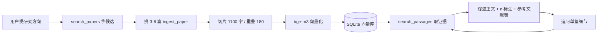

# 论文调研 Agent

输入一个研究方向，自动检索论文 → 全文入库 → 产出**每条结论都能追到原文片段**的文献综述 → 再针对单篇追问方法、超参、实验细节。

基于 EdgeOne Makers 的 `openai-agents-starter-python` 模板改造：原模板的天气 / 翻译玩具工具已替换为一套完整的论文检索 + RAG 证据链。

- **技术栈**：OpenAI Agents SDK (Python) + EdgeOne Makers + React/Vite/TS
- **对话模型**：任意 OpenAI 兼容接口（默认智谱 `glm-4.7-flash`）
- **向量模型**：`BAAI/bge-m3`（1024 维）
- **数据源**：Semantic Scholar、OpenAlex、arXiv、Unpaywall

---

## 一、核心能力

| 能力 | 实现 | 说明 |
|---|---|---|
| 主题检索 | `search_papers` | Semantic Scholar 主源，429 时自动切 OpenAlex |
| 精读元数据 | `get_paper_detail` | 标题/作者/年份/venue/被引数/DOI/arXiv/开放获取 PDF |
| 引用溯源 | `get_citations` | 谁引用了它、谁改进了它，用于梳理技术脉络 |
| 最新预印本 | `search_arxiv_latest` | arXiv Atom，按提交时间倒序，弥补期刊库滞后 |
| 全文入库 | `ingest_paper` | arXiv HTML → ar5iv → 开放获取 PDF → 摘要兜底 |
| 混合检索 | `search_passages` | BM25 + 向量 + RRF 融合，返回带 `paper_id` 和片段序号的原文 |
| 库内清单 | `list_ingested_papers` | 汇总已入库论文与片段数 |

前端配套：会话侧栏、工具调用指示灯、引用/出处面板、SSE 调试面板、一键导出 PDF、中英切换。

---

## 二、工作流程



三条硬约束把整条链路咬合起来：

1. **工具分工**：检索、入库、取证据不能跳步，没入库的论文读不到细节。
2. **引用规则**：每条结论后必须跟 `[1]` `[2]`（不接受 `[n]`、`[^1]`、`[1,2]`），文末必须有 `## 参考文献`，编号与正文一一对应。
3. **反编造**：片段里没有就答「未检索到支撑证据」，禁止用常识补全、禁止编造文献。

---

## 三、快速开始

### 环境要求

| 项目 | 版本 |
|---|---|
| Node.js | ≥ 18 |
| Python | ≥ 3.10（EdgeOne 运行时为 3.12） |
| EdgeOne CLI | `npm i -g edgeone` |

### 1) 装依赖

```bash
npm install
python -m venv .venv
# Windows
.venv/Scripts/python.exe -m pip install -r requirements.txt
# macOS / Linux
.venv/bin/python -m pip install -r requirements.txt
```

### 2) 配 `.env`

```bash
cp .env.example .env
```

至少要填 `LLM_API_KEY` / `LLM_BASE_URL` / `LLM_MODEL` 和 `EMBEDDING_API_KEY` / `EMBEDDING_BASE_URL` / `EMBEDDING_MODEL`，细节见下一节。

### 3) 连通性体检

```bash
.venv/Scripts/python.exe check_connectivity_min.py
```

三项（对话模型 / 向量 1024 维 / Semantic Scholar）全 PASS 再往下走。S2 报 429 属正常，冷却几分钟即可。

### 4) 跑冒烟测试

```bash
.venv/Scripts/python.exe scripts/smoke_paper_agent.py
```

不启动 Web 服务、不消耗对话模型额度，覆盖切片、分词、BM25、检索、入库、混合检索全链路。

```bash
scripts/smoke_paper_agent.py --skip-network      # 只验算法，不联网
scripts/smoke_paper_agent.py --arxiv-id ARXIV:2405.01234  # 换目标论文
```

### 5) 起服务

```bash
edgeone makers dev
```

- 聊天页：`http://localhost:8080`
- 本地观测：`http://localhost:8080/agent-metrics`

> Windows 下 `npm run dev:agents` 里写的是 `.venv/bin`，与 Windows 的 `.venv/Scripts` 不一致。直接用 `edgeone makers dev`（先激活 venv），或手动把 `PATH` 指向 `.venv/Scripts`。

前端单独调试：`npm run dev`；构建产物：`npm run build` → `dist/`。

---

## 四、环境变量

| 变量 | 必填 | 说明 |
|---|---|---|
| `LLM_API_KEY` | 是 | 对话模型 Key |
| `LLM_BASE_URL` | 是 | OpenAI 兼容地址，如 `https://open.bigmodel.cn/api/paas/v4` |
| `LLM_MODEL` | 否 | 默认 `@makers/deepseek-v4-flash`，实测建议 `glm-4.7-flash` 及以上 |
| `EMBEDDING_API_KEY` | 是 | 向量模型 Key |
| `EMBEDDING_BASE_URL` | 是 | 如 `https://api.siliconflow.cn/v1` |
| `EMBEDDING_MODEL` | 是 | 必须输出 1024 维，如 `BAAI/bge-m3` |
| `S2_API_KEY` | 否 | 留空走共享池，容易 429，代码已自动退避 |
| `OPENALEX_MAILTO` | 建议 | OpenAlex 礼貌池邮箱 |
| `UNPAYWALL_EMAIL` | 建议 | 必须是真实邮箱，否则 Unpaywall 不服务 |
| `VECTOR_STORE_PATH` | 否 | 默认 `./data/store.sqlite`，相对仓库根目录 |

`AI_GATEWAY_*` 三件套保留为兼容回退，仅在 `LLM_*` 缺失时生效。

**配置优先级是踩过坑的**：EdgeOne Makers 沙箱会预置同名 `AI_GATEWAY_API_KEY` / `AI_GATEWAY_BASE_URL` 指向平台内置网关，线上又没有 `.env`，裸读这两个变量会拿到平台键 → 401 `Invalid API key`。所以自定义了 `LLM_*` 前缀，线上在 Makers 控制台配这套变量后**重新部署**（热改无效）。

---

## 五、目录结构

```text
.
├── agents/                          # 有状态 Agent 函数（长任务）
│   ├── chat/index.py                # POST /chat        SSE 流式对话 + 指令 + 库内清单注入
│   ├── chat/stop.py                 # POST /stop        中止当前 run
│   ├── tools.py                     # 7 个 @function_tool
│   ├── _papers.py                   # 数据源层：S2 / OpenAlex / arXiv 归一化 + 限流兜底
│   ├── rag.py                       # 全文抓取 / 切片 / 向量化 / SQLite / BM25+向量+RRF
│   ├── _tools.py                    # 原模板示例工具，已不调用，可删
│   └── _logger.py
├── cloud-functions/                 # 无状态云函数（短请求）
│   ├── history/index.py             # POST /history
│   ├── conversations/index.py       # POST /conversations
│   ├── clear-history/index.py       # POST /clear-history
│   ├── delete-conversation/index.py # POST /delete-conversation
│   └── _logger.py
├── src/                             # React + Vite + TS 前端
│   ├── App.tsx                      # 主界面 + SSE 生命周期
│   ├── api.ts                       # 全部接口封装
│   ├── components/                  # ChatWindow / ChatInput / ConversationSidebar /
│   │                                # CitationPanel / DebugPanel / ToolLamp / ExportButton ...
│   ├── i18n/                        # 中英双语
│   └── lib/chatUiStore.ts           # 本地快照
├── scripts/smoke_paper_agent.py     # 端到端冒烟测试
├── check_connectivity_min.py        # 三项连通性体检
├── check_connectivity.py            # 完整版体检
├── api-schema.json                  # 七个工具的外部接口契约
├── PAPER-AGENT.md                   # 改造记录、验收步骤、设计取舍
├── data/store.sqlite                # 本地向量库（gitignore，可随时重建）
└── edgeone.json                     # framework=openai-agents-sdk，timeout=300s
```

> EdgeOne 约定：`_` 前缀为私有模块，不会暴露成路由。`tools.py` / `rag.py` 没有下划线，若部署时报路由冲突，改名 `_tools.py` / `_rag.py` 并同步 `chat/index.py` 的 import 即可。

---

## 六、接口一览

| 路由 | 文件 | 类型 | 作用 |
|---|---|---|---|
| `POST /chat` | `agents/chat/index.py` | SSE 流式 | 主对话。事件：`text_delta` / `tool_called` / `done` / `error` |
| `POST /stop` | `agents/chat/stop.py` | JSON | 真正中断 LLM 调用 |
| `POST /history` | `cloud-functions/history/index.py` | JSON | 拉取会话历史，刷新后恢复聊天窗 |
| `POST /conversations` | `cloud-functions/conversations/index.py` | JSON | 按 `user_id` 列会话，按 id 去重 |
| `POST /clear-history` | `cloud-functions/clear-history/index.py` | JSON | 清空某会话消息 |
| `POST /delete-conversation` | `cloud-functions/delete-conversation/index.py` | JSON | 彻底删除会话 |

身份靠前端 `localStorage` 的 `eo-uuid` 与 `eo_conversation_id`，请求头 `makers-conversation-id` 携带会话 id。

### 工具契约

每个工具的入参、上游端点、返回字段、限流策略都记在 `api-schema.json`，`paper_id` 统一带类型前缀：

```text
S2:<paperId>  |  DOI:10.xxxx/...  |  ARXIV:2405.01234  |  OA:W123456
```

前缀可跨数据源反解，库里以 `S2:` 存的论文用 `ARXIV:` 也能命中。

---

## 七、实现要点

| # | 取舍 | 原因 |
|---|---|---|
| 1 | **S2 一定 429** | 共享池按出口 IP 计数，连续调用几分钟就被封。检索 / 详情 / 引用三处都接了 OpenAlex 兜底，返回体 `source` 字段标明实际来源 |
| 2 | **限流硬编码** | S2 相邻请求 ≥1.2s，429/5xx 指数退避 2→16s 共 4 次；arXiv ≥3s；OpenAlex 0.3s |
| 3 | **切片按句边界** | 1100 字目标、180 字重叠，超长单句才硬切，避免把公式和上下文劈开 |
| 4 | **RRF 而非加权** | BM25 与余弦分数量纲不同，只看名次融合，省掉调参 |
| 5 | **向量落 SQLite** | float32 BLOB 存储，入库前 L2 归一化，检索用点积即余弦；开 WAL，sandbox 重启不丢 |
| 6 | **每轮注入库内清单** | 模型看不到本地 SQLite，不注入就会联网重搜已入库论文，白烧配额还答错。清单上限 20 篇、标题截 90 字，成本可忽略 |
| 7 | **弱模型会违反铁律** | 实测 `glm-4-flash` 内容对但丢 `[n]` 和文献表；`glm-4.7-flash` 遵守较好但高峰期限流。要稳定产出合规综述建议换更强模型 |

---

## 八、验收用例

| # | 输入 | 期望 |
|---|---|---|
| 1 | 帮我调研多模态大模型在城市积水监测中的应用 | `search_papers` → `ingest_paper`(3-6 篇) → `search_passages`；分节综述，每条带 `[1]`，末尾有 `## 参考文献` |
| 2 | 第二篇论文的 batch size 和学习率是多少？ | 先 `list_ingested_papers`，再 `search_passages(paper_id=...)`；片段没有就答「该论文入库片段中未提及此数值」 |
| 3 | 谁改进了这篇论文？ | `get_citations` 返回后续工作列表 |
| 4 | 最近三个月 arXiv 上有哪些新工作？ | `search_arxiv_latest`，按提交时间倒序 |
| 5 | 这个方向有哪些综述？（库里没有） | `search_papers` 联网检索，不得凭空列文献 |

**判断标准**：随便抽一句带 `[n]` 的话，去 `search_passages` 的返回片段里能对上原文，才算通过。

---

## 九、常见问题

| 现象 | 原因 | 处理 |
|---|---|---|
| 401 `Invalid API key` | 线上读到平台预置的 `AI_GATEWAY_*` | 控制台配 `LLM_*` 三项后重新部署；报错体里会打印实际生效的 `base_url` / `model` / key 来源 |
| `EMBEDDING_* 未配置` | `.env` 缺项 | 补齐后重跑体检 |
| `向量维度 xxx ≠ 1024` | 换过 embedding 模型 | 删 `data/` 重建 |
| 追问答「该论文尚未入库」 | 只 search 没 ingest | 先 `ingest_paper`，或看返回的 `abstract_only` |
| 入库很慢 | PDF 页数多 | 正常，18MB PDF 约 18s；arXiv HTML 通常 1s 内 |
| 综述里出现库里没有的论文 | 模型编造 | 换更强模型，或在 instructions 里再加硬约束 |
| `MaxTurnsExceeded` | 模型反复检索 | 已约束「同一问题最多检索 3 次」，仍超出说明模型太弱 |

---

## 十、已知限制

- **`data/store.sqlite` 会重置**：云上沙箱重新部署或实例回收后本地文件丢失。演示够用，长期保存需换对象存储或云数据库。
- **只覆盖开放获取内容**：付费墙论文只能拿到摘要，追问细节会缺证据（返回 `abstract_only=true`）。
- **arXiv 无被引数**：`citation_count` 恒为 `null`，需要被引数据请走 S2 / OpenAlex。
- **单次入库一篇**：批量入库容易超 300s 超时，综述建议只入最相关的 3-6 篇。

---

## 十一、文档与参考

- [`PAPER-AGENT.md`](./PAPER-AGENT.md) — 改造记录、手动步骤、设计取舍、FAQ
- [`api-schema.json`](./api-schema.json) — 七个工具的完整契约
- [EdgeOne Makers Agents 文档](https://pages.edgeone.ai/document/agents)
- [EdgeOne Makers 快速开始](https://pages.edgeone.ai/document/agents-quick-start)
- [OpenAI Agents SDK (Python)](https://openai.github.io/openai-agents-python/)

## License

MIT
